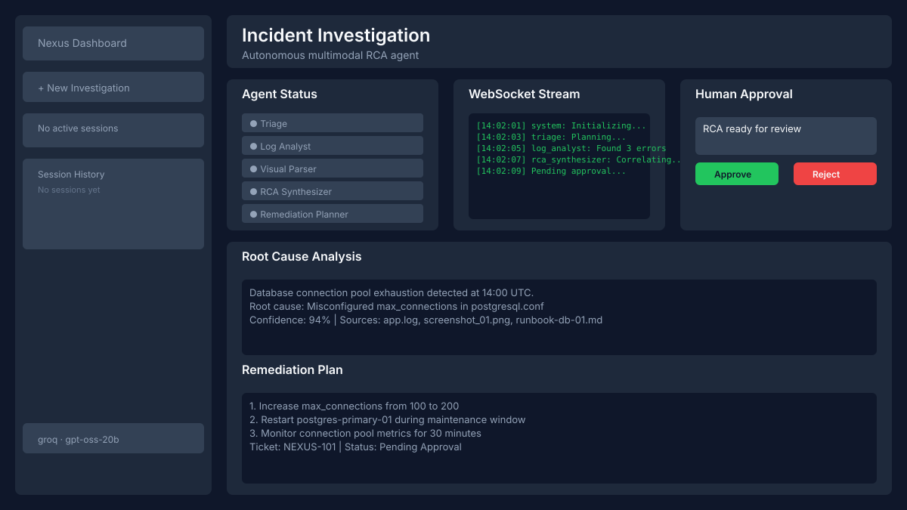

# Nexus — Autonomous Multimodal Incident Response Agent

NovaStark Hacks 2026 submission — Generative AI & Agentic Systems track.



## 📋 Overview
Nexus ingests multimodal incident evidence (logs, screenshots, runbook PDFs, chat transcripts), runs six autonomous agents in parallel, correlates root cause across text + images + documents, and drafts a remediation plan with a human-in-the-loop approval gate.

Built for the **NovaStark Hacks 2026** — Generative AI & Agentic Systems track.

## 🛠 Tech Stack
| Layer | Technology |
|-------|-----------|
| Backend | Python, FastAPI, Uvicorn, WebSocket |
| Agent Orchestration | Custom autonomous loop with approval gates |
| Agents | Triage, Log Analyst, Visual Parser, Runbook Retriever, RCA Synthesizer, Remediation Planner |
| LLM Providers | Groq (gpt-oss-20b), OpenAI (GPT-4o / GPT-4V) |
| Embeddings / Vector | ChromaDB (runbook retrieval) |
| PDF Parsing | pypdf |
| Frontend | Vanilla HTML + Tailwind CSS (zero build step) |
| Deployment | Vercel (frontend), Render (backend) |

## ✨ Features
- **Multimodal Ingestion**: Parse logs, PDFs, screenshots, and chat transcripts into structured artifacts
- **Six Autonomous Agents**: Triage → Log Analyst / Visual Parser / Runbook Retriever (parallel) → RCA Synthesizer → Remediation Planner
- **Human-in-the-Loop**: Approve or reject the synthesized RCA before a remediation ticket is created
- **Live WebSocket Stream**: Real-time agent reasoning traces streamed to the frontend
- **Demo Mode**: Full agentic flow works without an API key (placeholder LLM responses)
- **Health Endpoint**: `/api/health` returns registered agents and system status

## 🚀 Quick Start
```bash
# Clone
git clone https://github.com/19anveshh/nexus-agentic.git
cd nexus-agentic

# Configure environment (root level)
cp .env.example .env
# Add your OPENAI_API_KEY or GROQ_API_KEY to .env

# Install dependencies
pip install -r backend/requirements.txt

# Run the backend
cd backend
python main.py
# Server starts on http://0.0.0.0:8000

# Open the frontend
# Serve frontend/index.html with any static server, or open it directly
# Point it at http://localhost:8000
```

### Without an API key (demo mode)
If you don't set `OPENAI_API_KEY` or `GROQ_API_KEY`, the LLM wrapper falls back to demo-mode responses so you can demonstrate the full agentic flow, WebSocket streaming, and UI end-to-end.

## 🏗 Architecture
See [`docs/architecture.md`](docs/architecture.md) for the six-agent workflow diagram, data flow, and design decisions.

## 🤖 Agents
| Agent | Responsibility |
|-------|---------------|
| **Triage** | Decomposes the incident description into focused investigation tasks |
| **Log Analyst** | Parses log files for errors, exceptions, and anomalies |
| **Visual Parser** | Extracts text and structure from screenshots and images |
| **Runbook Retriever** | Searches runbook documents for relevant remediation steps |
| **RCA Synthesizer** | Correlates findings across all agents into a root cause analysis |
| **Remediation Planner** | Drafts an actionable remediation plan and ticket stub |

## 🧪 What I Learned
- Building autonomous agent orchestration with parallel execution and sequential synthesis
- Multimodal evidence ingestion (text + images + documents) into a unified packet
- Human-in-the-loop approval gates in agentic workflows
- WebSocket streaming of real-time agent traces to a zero-build frontend
- Deploying FastAPI backend on Render and static frontend on Vercel

## 🔮 Next Steps
- Swap placeholder LLM calls for real OpenAI GPT-4o / GPT-4V
- Replace ticket stub with real Jira/Slack webhook integration
- Add ChromaDB vector search over runbooks instead of keyword matching
- Add WebRTC / screen-capture ingestion for live war-room input
- Persistent session store (Redis/Postgres) instead of in-memory

## 📄 License
MIT

---
**Maddela Anvesh** · 2nd Year B.Tech CSE · [LinkedIn](https://linkedin.com/in/19anveshh) · [Portfolio](https://19anveshh-portfolio.vercel.app/)
